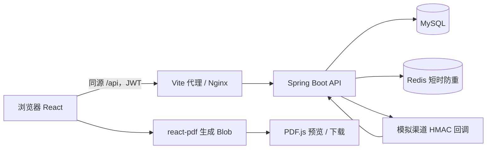
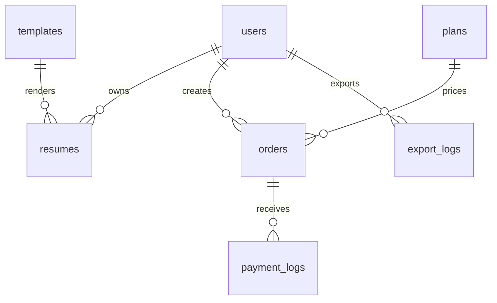

# 简历工坊 · Resume Craft

基于当前目录的原型和 M1 设计文档实现的前后端分离项目。游客浏览模板，登录后创建、编辑并导出简历，通过模拟支付开通会员。品牌、模板和界面为本项目原创，没有复制第三方站点代码或素材。

## 本地开发（Docker MySQL + Redis）

需要 Docker Desktop（Linux 容器）、Node.js 20.19+ / 22、JDK 21。`dev` 和 `prod` 均使用 MySQL 8.0、Redis 7 及同一套 MySQL Flyway 迁移。开发时在 Docker 中运行数据库，在本机运行 Java 和 Vite。

先启动 Docker Desktop，然后在项目根目录初始化配置并启动数据库。

```powershell
cd D:\cwj\resume_generator
.\init-env.ps1
docker compose -f compose.yml -f compose.dev.yml up -d --wait mysql redis
```

`init-env.ps1` 仅在 `.env` 不存在时生成随机密钥。后端从项目根目录或 `backend` 目录启动时，会自动读取根目录 `.env`。开发覆盖文件将 MySQL、Redis 分别绑定到 `127.0.0.1:3306` 和 `127.0.0.1:6379`。端口冲突时，在 `.env` 中调整 `DB_PORT`、`REDIS_PORT`，然后重新执行上述启动命令。

**终端一启动后端**

```powershell
cd D:\cwj\resume_generator\backend
.\mvnw.cmd spring-boot:run
```

如果目前只有 JDK 17，可以使用兼容模式。

```powershell
.\mvnw.cmd '-Djava.version=17' spring-boot:run
```

**终端二启动前端**

```powershell
cd D:\cwj\resume_generator\frontend
npm ci
npm run dev
```

- 前端：<http://127.0.0.1:5173>
- 健康检查：<http://127.0.0.1:8080/actuator/health>
- 开发接口文档：<http://127.0.0.1:8080/swagger-ui/index.html>，Knife4j：<http://127.0.0.1:8080/doc.html>
- 免费体验账号为 `user01 / 123456`，会员体验账号为 `vip01 / 123456`，仅 dev 环境自动创建。MySQL 数据保存在 Docker 命名数据卷 `mysql-data` 中。
- Linux/macOS 使用 `sh mvnw` 替代 `mvnw.cmd`。Wrapper 首次运行需要联网下载 Maven。

MySQL 首次启动时由 Flyway 自动初始化。日常停止数据库使用以下命令，后续启动会继续使用原有数据卷。

```powershell
docker compose -f compose.yml -f compose.dev.yml stop mysql redis
```

## 已实现

| 模块 | 功能 |
| --- | --- |
| 账号 | 注册、BCrypt 密码、2 小时 JWT、登录回跳、过期处理、昵称与邮箱修改 |
| 模板 | 现代简约 / 经典商务（免费），清新活力 / 极简黑白（会员）；筛选、搜索、详情、使用权限校验 |
| 编辑 | 基本信息、教育、工作、项目、技能标签、自定义模块；增删改、拖动/按钮排序、日期校验、50%–100% 缩放、实时预览、模板切换 |
| 保存 | 800ms 防抖、串行提交、version 乐观锁、本地草稿、离线保留、网络恢复重试、手动保存 |
| 我的简历 | 列表、重命名、复制、二次确认删除；所有资源由后端校验所有者 |
| 导出 | 四种真实 PDF、A4 自动分页、内置静态中文字体、免费水印、逐页 PDF.js 预览、下载、导出记录 |
| 权益 | 免费每天 1 次，按服务器中国时间自然日重置；会员不限次数；会员状态实时查库 |
| 支付 | 月度 19.9 元 / 30 天，年度 99 元 / 365 天；服务端定价、创建订单幂等、15 分钟过期、模拟成功/失败、HMAC 验签、金额校验、并发回调幂等、续期叠加、退款演示 |
| 工程 | Spring Boot 3.5、MyBatis-Plus、Flyway、React 19、TypeScript、Vite 6、Tailwind 4、TanStack Query、zustand、Axios、Docker Compose、CI |

编辑器面向桌面，最小宽度 1024px；模板、登录、会员、个人中心提供窄屏布局。HTML 预览呈现整份内容，导出 PDF 自动分页，两者使用同一模块顺序和内容结构。

### 当前边界

- **支付为沙箱演示，不会真实扣款。** `prod` 模式禁用模拟支付、退款演示和默认账号；真实微信/支付宝渠道仍需商户资质、渠道 SDK、对账及上线配置。线上结算会明确显示渠道未开通。
- P1 的头像上传尚未实现。模板详情目前提供单份完整预览，没有额外准备 2–3 张静态内页图。
- Redis 用于导出短时防重；每日额度以数据库导出日志和用户行锁为准。与初始文档中“Redis 主计数 + DB 日志”不同，这样可以避免 Redis 不可用时超额放行。
- 免费额度采用“预留 → 生成 → 确认”两阶段：生成失败主动释放，失联预留 10 分钟后可回收。PDF 在客户端生成，下载确认仅表示浏览器已生成文件，不保证用户已将文件保存到磁盘。
- PDF.js 显示页码与总页数，导出文件不添加动态页码。中文静态常规/粗体已校正字体内部名称，避免 PDF 字体缓存混淆。
- 客户端 PDF 生成适合本次作品集范围；正式商业化若需防止绕过前端导出，应迁移为服务器生成并鉴权下载。
- 退款仅演示状态变更与会员扣回，扣回该套餐的完整天数、最低回退至当前时间，没有真实资金退款。
- 无 AI、公开分享、密码找回和自动续费。

## 目录

```text
frontend/                       React 页面、编辑器、PDF 生成/预览、Nginx
  src/app/                      路由入口
  src/components/               通用 UI、布局和简历预览组件
  src/features/                 auth、templates、editor、workspace、membership、pdf
    editor/pages/               编辑器页面入口
    editor/components/          工具栏、预览、模块表单和弹窗
    editor/hooks/               草稿自动保存和 PDF 导出状态
  src/api/                      业务请求
  src/lib/                      HTTP 客户端
  src/stores/                   登录状态和消息通知
  src/styles/                   按页面和组件职责拆分的样式
  scripts/verify-pdf.mjs         四模板与长简历 PDF 集成检查
  public/fonts/                 Noto Sans SC 常规/粗体和 OFL 许可证
backend/                        Spring Boot API
  src/main/java/cn/resumecraft/
    api/                        按资源拆分的控制器、统一响应与异常
    dto/                        独立请求和响应对象
    model/                      每个数据库实体独立文件
    service/                    认证、简历、订单、支付和导出业务
    mapper/                     MyBatis-Plus Mapper
    security/                   JWT 签发、认证过滤器和认证异常响应
    config/                     安全链与开发账号配置
  src/main/resources/db/migration/mysql/
  src/test/resources/            测试配置
  src/test/                     按认证、简历、支付、导出拆分的 11 项集成测试
docs/                           演示步骤、验收记录、截图
compose.yml                     MySQL + Redis + 后端 + 前端/Nginx
compose.dev.yml                 本地开发的 MySQL、Redis 端口映射
resume-maker.html               用户原始静态原型（保留）
resume-maker-m1-design.md        用户原始设计文档（保留）
```

## 代码检查与格式

前端使用 oxlint 检查 TypeScript、React Hooks、可访问性和循环导入，使用 oxfmt 统一格式。页面入口组合业务组件，自动保存、PDF 生成和 PDF 页面渲染各自位于独立模块。

```powershell
cd frontend
npm run lint
npm run format
npm run format:check
npm run check
```

`npm run check` 依次执行静态检查、格式检查、类型检查和生产构建。后端使用 Spotless 与 Google Java Format，`verify` 阶段自动检查格式。

```powershell
cd backend
.\mvnw.cmd spotless:apply
.\mvnw.cmd verify
```

GitHub Actions 执行上述前端检查、PDF 回归和后端验证。

## 业务与数据





开发、测试和生产统一使用 MySQL。数据库 7 张业务表，另外增加 Flyway 迁移历史表。MySQL 使用 JSON 保存简历和套餐权益，金额始终以整数“分”存储。

支付锁定顺序统一为用户 → 订单；签名通过、金额一致、订单未过期时才允许 `CREATED → PAID`。订单状态和会员续期在同一事务提交，交易流水唯一。会员到期时间不写入 JWT。

保存接口要求 `version`，冲突返回 409，前端保留本地草稿。免费导出时用户行锁串行校验 `PENDING / COMPLETED` 数量，避免并发超额。资源的 GET / PUT / DELETE / 复制、订单和导出接口都校验本人身份。

## 完整 Docker Compose 部署

前端、后端和数据库均在 Docker 中运行时，使用基础编排。Java 构建和运行均使用容器内的 JDK 21。

```powershell
cd D:\cwj\resume_generator
.\init-env.ps1
docker compose up --build -d
```

访问 <http://127.0.0.1:8088>。基础编排中的 MySQL、Redis 通过 Docker 内网连接。`compose.dev.yml` 用于本地开发的端口映射，生产部署仅使用基础编排。两种方式复用同一组数据卷。

默认 `APP_PROFILE=dev` 可演示模拟支付；改为 `prod` 后关闭开发功能。正式上线还需要域名、HTTPS、数据库备份、真实支付集成及运维配置。`compose` 只绑定本机地址，生产部署应按实际网关调整。

## 验证

先启动 Docker Desktop。后端测试使用 Testcontainers 自动创建临时 MySQL 8.0 容器，分配随机端口，并执行与开发、生产相同的 Flyway 迁移。测试结束后自动移除容器，测试数据保存在该临时容器中。运行测试只需 Docker 引擎可用。

```powershell
cd backend
.\mvnw.cmd '-Djava.version=17' verify
cd ../frontend
npm run build
npm run test:pdf
```

JDK 21 去掉版本覆盖参数。PDF 检查使用生产模板组件，验证四种模板中文、A4 尺寸、水印；构造长简历检查自动分成多页，15 个工作条目及末尾技能模块都未丢失。临时检查文件保存在忽略目录 `frontend/.tools/pdf-check/`。

业务测试覆盖 BCrypt/重复注册、未登录拦截、跨账号操作、VIP 校验、乐观锁冲突、并发下单幂等、支付回调并发重放、验签/金额/订单过期、退款与续费、并发导出额度和失败回收。

`MySqlTestConfiguration` 中集中定义测试数据库。Spring Boot 的 `@ServiceConnection` 自动提供连接参数，CI 使用相同测试入口。

2026-11-06 已在本机 Docker MySQL 8.0.46、Redis 7 上完成验证。两条 MySQL Flyway 迁移、11 项 Testcontainers MySQL 集成测试、中文 JSON 保存回读、乐观锁 409、Redis 防重 429，以及 MySQL 容器重启后的数据回读均通过。Testcontainers 测试在没有 `.env` 时也能独立运行。验证使用 JDK 17 兼容模式。

## 页面截图

模板中心、编辑器、会员页与个人中心截图位于 `docs/screenshots/`，由实际本地页面捕获。


