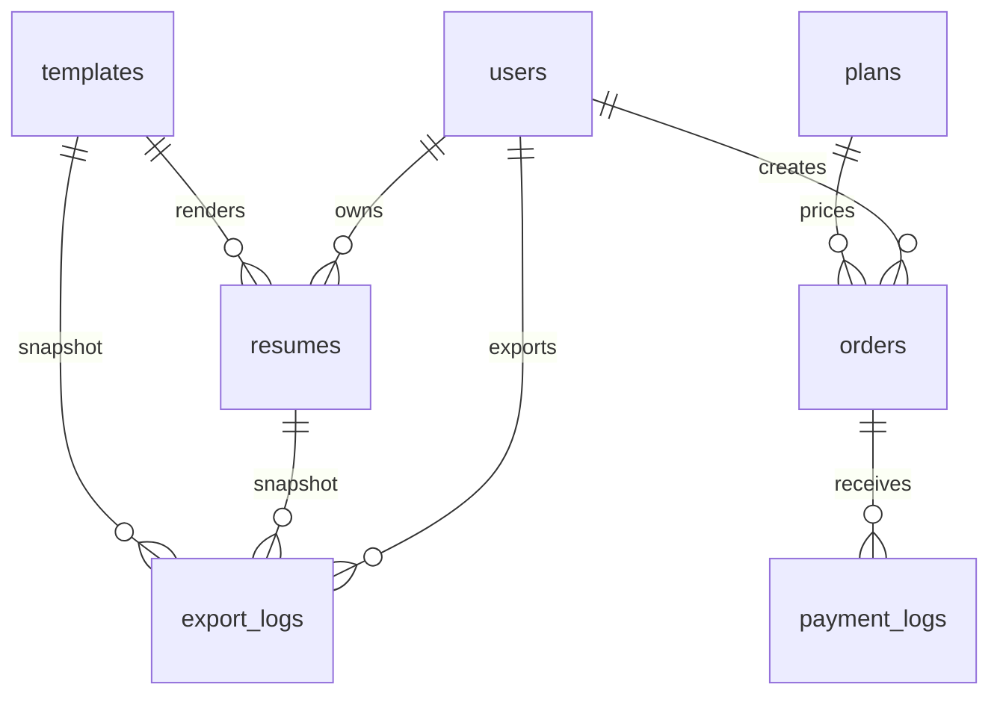

# 简历工坊（Resume Craft）· 全栈功能清单（2026-11）

> 定位：全栈求职作品集项目（仿格物简历同类产品，模板与 UI 原创）。4 周、15–18k 保底上岸。
> 用途：**给 AI Agent 按功能点逐步开发**。每个功能点（F 编号）可独立实现、独立验收，做一个了解一个。
> 配套：静态原型 `prototype/resume-maker.html`（浏览器双击打开）。
> 边界：本文只定 M1（全栈闭环）；AI 润色、AI 排版建议等属于 M2，见 §11 预留。

---

## 0. 一句话概括

游客浏览模板 → 注册登录 → 选模板创建简历 → 在线编辑（左表单右 A4 实时预览）→ 导出 PDF → 付费开通会员解锁 VIP 模板与导出权益。核心闭环：**认证、模板渲染、PDF 导出、订单支付**。

---

## 1. 范围与边界

### 1.1 明确要做

| 模块       | 内容                                                                               |
| ---------- | ---------------------------------------------------------------------------------- |
| 认证       | 注册、登录（JWT）、个人资料                                                        |
| 模板中心   | 4 套原创模板，列表/详情/筛选，免费与 VIP 标签                                      |
| 简历编辑器 | 基本信息/教育/工作/项目/技能模块增删改、拖拽排序、实时 A4 预览、自动保存、模板切换 |
| 导出       | PDF 生成（react-pdf）、导出权益校验、导出记录、导出后预览                          |
| 会员支付   | 套餐定价、创建订单、模拟支付、回调验签+幂等、会员开通/续期、权益展示、退款演示     |

### 1.2 明确不做（写进合同的边界）

| 不做                           | 原因                                     | 何时     |
| ------------------------------ | ---------------------------------------- | -------- |
| 拖拽式自由排版（整页拖拽布局） | 4 周做不完；表单+模板渲染已覆盖核心      | 不做     |
| AI 润色 / AI 生成简历内容      | M2（接 LLM），M1 不碰                    | M2       |
| 微信真实支付                   | 无商户资质；用模拟支付，逻辑按生产标准写 | 面试讲   |
| 简历对外公开分享页             | 隐私敏感，演示不需要                     | 之后按需 |
| 找回密码（邮件/短信）          | 演示不需要                               | 不做     |
| 多语言（i18n）                 | 中文市场                                 | 不做     |
| 移动端完整适配                 | 面试官 PC 访问；编辑器保证 ≥1024px       | 不做     |

---

## 2. 技术选型

| 层       | 选型                                                                      | 版本/说明                                          |
| -------- | ------------------------------------------------------------------------- | -------------------------------------------------- |
| 后端     | Spring Boot                                                               | 3.5.x（生态稳、JD 命中率高）                       |
| JDK      | Eclipse Temurin                                                           | 21 LTS                                             |
| 数据库   | MySQL                                                                     | 8.0，utf8mb4，InnoDB                               |
| ORM      | MyBatis-Plus                                                              | 3.5.9（boot3 starter）                             |
| 迁移     | Flyway                                                                    | `V1__schema.sql` + `V2__seed.sql`，禁止 `ddl-auto` |
| 缓存     | Redis                                                                     | 7：导出限流、模板浏览量缓存                        |
| 认证     | Spring Security + JWT（jjwt 0.12.x）                                      | BCrypt，无状态                                     |
| 接口文档 | springdoc-openapi + Knife4j                                               | `/doc.html`                                        |
| 前端     | React 19 + TypeScript + Vite 6                                            | SPA                                                |
| 前端库   | React Router 7、ahooks 3、zustand 5、Tailwind CSS 4、axios、dayjs         |                                                    |
| PDF 生成 | @react-pdf/renderer 4.x                                                   | React 组件写模板；中文注册字体（Noto Sans SC）     |
| PDF 预览 | 浏览器 iframe（默认）｜pdfjs-dist（可选增强）                             | 见 §8                                              |
| 部署     | Docker Compose + Nginx + GitHub Actions                                   | 单机                                               |

---

## 3. 数据库设计（7 张表）

统一约定：MySQL 8.0 / InnoDB / utf8mb4；所有表主键 `BIGINT PRIMARY KEY AUTO_INCREMENT`；时间列用 `TIMESTAMP`；金额列用 `INT` 存「分」；枚举列用 `VARCHAR` 存大写常量。DDL 与种子数据由 Flyway 管理（`db/migration/mysql/V1__schema.sql`、`V2__seed.sql`），不使用 `ddl-auto`。

| 表             | 字段                                                                                                                  | 说明                                             |
| -------------- | --------------------------------------------------------------------------------------------------------------------- | ------------------------------------------------ |
| `users`        | id, username, password_hash, email, nickname, avatar_url, member_expire_at, created_at                                | 账号与会员状态；会员到期时间冗余在用户表，查询快 |
| `templates`    | id, name, category, is_vip, color, style, sort, used_count                                                            | 模板样式元数据；种子数据 4 套                    |
| `resumes`      | id, user_id, template_id, title, content(JSON), version, status, created_at, updated_at                               | content 存整份简历结构化数据（JSON），见 D1      |
| `plans`        | id, name, price, duration_days, features(JSON), sort                                                                  | 套餐定价；种子数据 2 套                          |
| `orders`       | id, order_no, user_id, plan_id, amount, status, channel, request_key, transaction_id, created_at, paid_at, expired_at | 订单状态机，见 F25                               |
| `payment_logs` | id, order_id, channel, raw_body, result, created_at                                                                   | 回调原始报文留痕，排查/演示用                    |
| `export_logs`  | id, user_id, resume_id, template_id, status, created_at                                                               | 导出预留与记录，免费次数统计依据                 |

**关键决策：**

- **D1 简历内容用 JSON 列存储**，不用教育/工作等拆多表。理由：简历是"文档"不是"业务实体"，不存在跨简历的关联查询；JSON 天然适配"不同模板取不同字段渲染"。**代价**：面试要能讲清"什么时候该拆表、什么时候该 JSON"。
- **D2 订单金额用"分"（int）存储**，不用 decimal。理由：规避浮点误差，支付行业惯例。面试直接讲。
- **D3 会员到期用 `member_expire_at` 时间戳**：续费 = `MAX(now, 当前到期时间) + 天数`，同一时刻只可能有一个值，无需状态机。
- **D4 主键统一数据库自增**：7 张表全部 `AUTO_INCREMENT`，实体只写 `@TableId`（走全局 `id-type: auto`），种子脚本不写死 ID，初始编号由插入顺序决定。禁止 `IdType.INPUT` 手工指定主键：配置表一旦写死 ID，后续新增模板/套餐就得手工避让编号，容易撞号。修改已执行过的迁移脚本会使 Flyway checksum 校验失败，需重建数据卷（`docker compose down -v`）后再启动。

### 3.1 索引与唯一约束

| 名称                           | 定义                          | 服务的查询               |
| ------------------------------ | ----------------------------- | ------------------------ |
| `users.username`               | UNIQUE                        | 注册查重、登录查询       |
| `orders.order_no`              | UNIQUE                        | 回调按单号定位订单       |
| `orders.transaction_id`        | UNIQUE                        | 渠道流水唯一，防重复入账 |
| `orders(user_id, request_key)` | UNIQUE                        | 下单幂等                 |
| `idx_resumes_user`             | (user_id, updated_at)         | 我的简历列表倒序         |
| `idx_orders_expiry`            | (status, expired_at)          | 定时任务批量关闭过期订单 |
| `idx_export_quota`             | (user_id, created_at, status) | 免费用户每日额度统计     |

### 3.2 表关系图



关系说明：

| 关系                    | 基数 | 外键约束       | 说明                                             |
| ----------------------- | ---- | -------------- | ------------------------------------------------ |
| users → resumes         | 1:N  | 有             | 一个用户多份简历；列表、权限校验都按 user_id     |
| templates → resumes     | 1:N  | 有             | 一个模板可被多份简历引用；换模板只改 template_id |
| users → orders          | 1:N  | 有             | 一个用户多笔订单；订单详情/列表校验本人          |
| plans → orders          | 1:N  | 有             | 套餐决定下单金额快照与会员天数                   |
| orders → payment_logs   | 1:N  | 有             | 一笔订单的每次回调各留一条审计记录               |
| users → export_logs     | 1:N  | 有             | 免费用户每日额度按 user_id 统计                  |
| resumes → export_logs   | 1:N  | 无（逻辑引用） | 记录导出时的简历；简历删除后历史仍保留           |
| templates → export_logs | 1:N  | 无（逻辑引用） | 导出时的模板快照；事后换模板不影响统计           |

> 只有 `export_logs.user_id` 建了外键，`resume_id` 与 `template_id` 故意不建外键：避免删除简历/模板时历史导出记录被级联删除，同时保留「导出当时用的是哪份简历、哪个模板」的事实快照。图中这两条线表示逻辑引用，不是数据库外键约束。

### 3.3 枚举取值

| 列                    | 取值                                    | 迁移规则                                                                    |
| --------------------- | --------------------------------------- | --------------------------------------------------------------------------- |
| `orders.status`       | CREATED / PAID / EXPIRED / REFUNDED     | 只通过带 `WHERE status='旧值'` 的条件 UPDATE 迁移；`affected == 1` 才算成功 |
| `payment_logs.result` | SUCCESS / FAILED / DUPLICATE / REFUNDED | 追加式写入，不更新                                                          |
| `export_logs.status`  | PENDING / COMPLETED / FAILED            | PENDING → COMPLETED / FAILED；超时 PENDING 自动回收为 FAILED                |
| `resumes.status`      | DRAFT                                   | 预留扩展                                                                    |

---

## 4. 功能点总表

> 优先级：P0 = 必须（4 周内全部完成）；P1 = 建议（时间够就做）；P2 = 可选加分。

| 编号 | 功能                        | 模块     | 阶段 | 优先级 |
| ---- | --------------------------- | -------- | ---- | ------ |
| F01  | 后端工程初始化              | 工程底座 | 0    | P0     |
| F02  | 统一响应与异常处理          | 工程底座 | 0    | P0     |
| F03  | Flyway 建表 + 种子数据      | 工程底座 | 0    | P0     |
| F04  | 前端工程初始化              | 工程底座 | 0    | P0     |
| F05  | 注册                        | 认证     | 1    | P0     |
| F06  | 登录（JWT）                 | 认证     | 1    | P0     |
| F07  | 前端路由守卫                | 认证     | 1    | P0     |
| F08  | 个人资料编辑                | 认证     | 1    | P1     |
| F09  | 模板列表页                  | 模板中心 | 2    | P0     |
| F10  | 模板详情页                  | 模板中心 | 2    | P0     |
| F11  | 新建简历（选模板）          | 编辑器   | 3    | P0     |
| F12  | 我的简历列表（CRUD）        | 编辑器   | 3    | P0     |
| F13  | 编辑器骨架（表单+预览布局） | 编辑器   | 3    | P0     |
| F14  | 基本信息模块                | 编辑器   | 3    | P0     |
| F15  | 教育经历模块                | 编辑器   | 3    | P0     |
| F16  | 工作经历模块（含排序）      | 编辑器   | 3    | P0     |
| F17  | 项目/技能/自定义模块        | 编辑器   | 3    | P0     |
| F18  | 自动保存草稿                | 编辑器   | 3    | P0     |
| F19  | 模板切换                    | 编辑器   | 3    | P0     |
| F20  | PDF 生成（react-pdf）       | 导出     | 4    | P0     |
| F21  | 导出权益校验（后端）        | 导出     | 4    | P0     |
| F22  | 导出后预览与下载            | 导出     | 4    | P0     |
| F23  | 导出失败兜底                | 导出     | 4    | P1     |
| F24  | 会员定价页                  | 会员     | 5    | P0     |
| F25  | 创建订单                    | 会员     | 5    | P0     |
| F26  | 模拟支付                    | 会员     | 5    | P0     |
| F27  | 支付回调（验签+幂等）       | 会员     | 5    | P0     |
| F28  | 会员状态与权益展示          | 会员     | 5    | P0     |
| F29  | 退款演示                    | 会员     | 5    | P1     |
| F30  | Docker Compose 部署         | 部署     | 6    | P0     |
| F31  | README + 架构图             | 部署     | 6    | P0     |
| F32  | 面试演示脚本                | 部署     | 6    | P0     |
| F33  | 导出预览增强（pdfjs-dist）  | 导出     | 6    | P2     |

---

## 5. 功能点明细（含验收标准）

> 每个功能点的"验收标准"就是 AI Agent 完成该功能的测试用例；"面试讲点"是做完后你要能讲出来的话。

### 阶段 0：工程底座

**F01 后端工程初始化**

- 验收：`mvn spring-boot:run` 启动成功；`GET /actuator/health` 返回 UP；dev/prod 双 profile。
- 面试讲点：为什么选 Boot 3.5 而非 Boot 4（生态成熟度）；分层结构 controller/service/mapper。

**F02 统一响应与异常处理**

- 验收：所有接口返回 `{code, message, data}`；参数校验失败返回 400 且 message 可读；未知异常 500 不泄露堆栈；业务异常抛 `BizException(ErrorCode)`。
- 面试讲点：`@RestControllerAdvice` + `@ExceptionHandler` 原理；为什么错误码要和 HTTP 状态码分离。

**F03 Flyway 建表 + 种子数据**

- 验收：启动自动执行 `V1__schema.sql`（7 张表 + 索引）；`V2__seed.sql` 写入 4 套模板、2 个套餐（主键由数据库自增，脚本不写死 ID）；dev profile 启动时由 `DemoSeed` 创建测试账号（user01/123456、vip01/123456）。
- 面试讲点：Flyway 版本化迁移 vs `ddl-auto`；种子数据与业务数据的边界。

**F04 前端工程初始化**

- 验收：Vite 启动；路由 6 条（`/`、`/login`、`/register`、`/templates`、`/editor/:id`、`/pricing`、`/me`）；axios 拦截器自动带 token、401 统一跳登录；Tailwind 生效。
- 前端通过 axios 拦截器处理认证与错误，使用 ahooks `useRequest` 管理请求状态、缓存、重试与轮询。写操作完成后显式刷新对应数据。

### 阶段 1：认证

**F05 注册**

- 验收：用户名唯一（并发注册同名只成功一个）；密码 BCrypt 存储；注册成功返回 JWT 直接登录。
- 面试讲点：BCrypt 为什么安全（盐值内置+自适应成本）；唯一索引 + 异常兜底双保险。

**F06 登录**

- 验收：正确账号返回 JWT（含 userId/username/memberExpireAt）；错误统一提示"用户名或密码错误"（不区分哪个错，防枚举）；JWT 过期时间 2h 可配置。
- 面试讲点：JWT 无状态 vs Session；为什么密码错误不能提示"用户不存在"。

**F07 前端路由守卫**

- 验收：未登录访问 `/editor` 跳登录并带 redirect 回跳；token 过期后下一次请求自动清空并跳登录。
- 面试讲点：前端守卫只是体验，真正的安全在后端接口（403）。

**F08 个人资料编辑**（P1）

- 验收：头像上传（静态目录 + 大小限制 2MB）、昵称修改即时生效。

### 阶段 2：模板中心

**F09 模板列表页**

- 验收：网格展示 4 套模板（封面 + 名称 + 使用人数 + 免费/VIP 角标）；按"全部/免费/VIP"筛选；点击卡片进详情。
- 面试讲点：列表分页怎么做（MyBatis-Plus Page）；used_count 用 Redis 缓存 + 定时落库（或直接 DB count）。

**F10 模板详情页**

- 验收：封面大图 + 2-3 张内页预览图（静态资源）；"使用此模板"按钮：未登录跳登录，已登录进编辑器；VIP 模板对非会员点击时弹会员引导。
- 面试讲点：VIP 模板的解锁校验放在后端（前端藏按钮不防爬）。

### 阶段 3：简历编辑器（核心）

**F11 新建简历（选模板）**

- 验收：从模板详情"使用"进入，后端创建 resume（默认标题"我的简历-{模板名}"）；免费用户可选免费模板，VIP 模板校验会员资格。
- 面试讲点：资源创建接口的权限校验（模板归属、会员资格）。

**F12 我的简历列表**

- 验收：`/me` 展示我的简历卡片（模板缩略图 + 标题 + 更新时间）；重命名、复制（content 深拷贝）、删除（二次确认）。
- 面试讲点：复制时 JSON 深拷贝的坑（Jackson 反序列化再序列化，避免对象引用共享）。

**F13 编辑器骨架**

- 验收：左侧模块表单（tab 切换）+ 右侧 A4 比例预览（宽度自适应、缩放 50%-100%）；顶栏：模板名、保存状态、模板切换、导出按钮。
- 面试讲点：A4 比例 1:1.414 用 `aspect-ratio: 210/297` 实现；预览与导出一致性（同用一套模板渲染函数——这是 react-pdf 方案的卖点）。

**F14 基本信息模块**

- 验收：姓名/求职意向/电话/邮箱/城市/个人简介字段；输入实时同步预览；电话格式校验提示。
- 面试讲点：表单受控组件；校验时机（失焦 vs 提交）。

**F15 教育经历模块**

- 验收：增删改条目；时间段校验（结束时间不能早于开始）；预览按时间倒序排列。
- 面试讲点：数组表单的状态管理（zustand）；时间倒序排序。

**F16 工作经历模块（含排序）**

- 验收：条目增删改 + 拖拽排序（react-dnd 或原生 HTML5 DnD）；职责描述支持多条（bullet 列表）；排序结果持久化到 content JSON。
- 面试讲点：拖拽排序实现选择；为什么排序存在 JSON 里而不是单独 sort 字段。

**F17 项目/技能/自定义模块**

- 验收：项目经验（同工作经历结构）；技能用标签输入（回车添加、点击删除）；"自定义模块"（标题+内容，可增删）。
- 面试讲点：JSON 结构的灵活性——自定义模块不需要改表。

**F18 自动保存草稿**

- 验收：编辑停顿 800ms 后自动 PUT 保存；顶栏显示"保存中/已保存 HH:mm"；刷新页面数据不丢；网络失败提示并保留本地。
- 面试讲点：防抖 + 竞态（后发请求覆盖先发的处理）；为什么不做 WebSocket 实时保存（无必要）。

**F19 模板切换**

- 验收：编辑器内切换 4 套模板，数据不变、渲染即时变化；VIP 模板对非会员弹开通引导；切换后 content 不变只改 template_id。
- 面试讲点：模板 = 纯渲染层（presentation），数据与展示分离——这是和"拖拽排版"方案的根本区别。

### 阶段 4：导出

**F20 PDF 生成（react-pdf）**

- 验收：4 套模板各产出对应 PDF；A4 分页正确（内容超一页自动翻页且不截断条目）；中文正常（注册 Noto Sans SC 字体）；文件名 `{姓名}-{求职意向}.pdf`。
- 面试讲点：为什么 react-pdf 而不是 html2pdf（分页控制）/iText（排版成本）；字体注册与中文乱码的坑。

**F21 导出权益校验（后端）**

- 验收：`POST /api/exports` 校验：免费用户每天 1 次、会员不限；成功则写 export_logs 并返回放行；超限返回 403 + 剩余时间提示；Redis 计数 + DB 落日志双写。
- 面试讲点：限流计数为什么放 Redis（快、可过期）；免费次数的重置策略（自然日 vs 24 小时滚动）。

**F22 导出后预览与下载**

- 验收：前端生成 PDF blob → 弹窗内 iframe 预览 → "下载"按钮触发浏览器下载；导出成功后向后端上报一次导出记录。
- 面试讲点：Blob URL 生命周期（URL.revokeObjectURL 防内存泄漏）。

**F23 导出失败兜底**（P1）

- 验收：生成失败（字体加载失败/超时）给出可读错误与重试；免费次数"先校验后扣减"失败时自动回滚（顺序保证不误扣）。

### 阶段 5：会员与支付

**F24 会员定价页**

- 验收：月度 ¥19.9 / 年度 ¥99 两卡（对比权益：VIP 模板、无限导出、去水印）；当前会员状态显示"已开通至 xxxx-xx-xx"。
- 面试讲点：价格用"分"存储、前端元转分展示。

**F25 创建订单**

- 验收：选套餐生成订单（order_no 格式 `RC`+日期+随机数）；状态 `CREATED`；15 分钟未支付自动过期（定时任务扫 expired_at）；重复点击不重复创建（幂等）。
- 面试讲点：订单状态机 `CREATED → PAID / EXPIRED / REFUNDED`；过期关闭用 `@Scheduled` 批量 UPDATE。

**F26 模拟支付**

- 验收：支付页展示订单信息 + 倒计时；"模拟支付成功/失败"按钮（dev 环境）；生产环境走真实渠道占位。
- 面试讲点：模拟支付只绕过"渠道"，不绕过回调逻辑——回调链路按生产标准写。

**F27 支付回调（验签+幂等）**

- 验收：`POST /api/pay/callback` 验签（HMAC-SHA256，secret 配置化）；验签失败 400；成功但订单已 PAID → 直接返回 success（幂等）；`CREATED → PAID` 后开通会员（`member_expire_at = MAX(now, 原值) + 天数`）并写 payment_logs；同一回调重放 10 次只生效 1 次。
- 面试讲点：**这是全项目最硬的 Java 点**——回调幂等 = 状态机 + 数据库唯一约束/状态条件 UPDATE；为什么支付回调必须异步不信任通知内容。

**F28 会员状态与权益展示**

- 验收：个人中心显示会员到期时间/身份徽章；JWT 过期时间与会员到期时间分离（会员状态实时查库，不写进 JWT）；VIP 模板解锁、导出不限次数生效。
- 面试讲点：为什么会员状态不塞 JWT（权益变更要即时生效）。

**F29 退款演示**（P1）

- 验收：个人中心订单列表"申请退款"→ 订单 `REFUNDED`，会员到期时间回退该订单对应天数；日志记录。
- 面试讲点：退款的状态机边界（只有 PAID 可退）。

### 阶段 6：部署与文档

**F30 Docker Compose 部署**

- 验收：`docker compose up -d` 一键起 mysql/redis/backend/frontend/nginx；前端构建产物由 Nginx 托管并代理 `/api`；数据卷持久化。
- 面试讲点：前后端分离部署 + 反代；环境变量管理密钥（JWT secret、支付 secret 不进仓库）。

**F31 README + 架构图**

- 验收：README 含架构图（ASCII/mermaid）、表关系图、启动步骤、账号密码；截图 4 张（首页/编辑器/定价/个人中心）。
- 面试讲点：README 是面试官点进 GitHub 的第一眼。

**F32 面试演示脚本**

- 验收：90 秒走查：注册登录 → 选免费模板 → 编辑（演示实时预览）→ 导出 PDF 下载 → 买会员（模拟支付回调）→ 解锁 VIP 模板再导出一次。全程无外部依赖、可离线演示。
- 面试讲点：背熟这条线，每次面试照演。

**F33 导出预览增强（pdfjs-dist）**（P2）

- 验收：导出弹窗内用 pdfjs-dist 渲染逐页预览 + 缩放控件；加载失败回退 iframe。

---

## 6. 开发顺序与依赖图

```
阶段0 ──▶ 阶段1 ──▶ 阶段2 ──▶ 阶段3 ──────▶ 阶段4 ──▶ 阶段5 ──▶ 阶段6
底座      认证      模板中心   编辑器        导出       会员支付    部署
F01-04   F05-08    F09-10    F11-19       F20-23     F24-29     F30-33
  │         │        │         │             │          │
  └─────────┴────────┴─────────┴─────────────┴──────────┘
                    依赖：前置完成才可验收

阶段 1 完成即可登录演示；阶段 3 完成是"产品可用"里程碑；
阶段 5 完成是"商业闭环"里程碑（面试核心证据）。
```

---

## 7. API 清单（REST，统一 `/api` 前缀，JWT 头认证）

| 方法    | 路径                        | 功能点                     | 鉴权 |
| ------- | --------------------------- | -------------------------- | ---- |
| POST    | /api/auth/register          | 注册                       | 公开 |
| POST    | /api/auth/login             | 登录                       | 公开 |
| GET/PUT | /api/users/me               | 我的资料                   | 登录 |
| GET     | /api/templates              | 模板列表（筛选参数）       | 公开 |
| GET     | /api/templates/{id}         | 模板详情                   | 公开 |
| POST    | /api/resumes                | 新建简历（选模板）         | 登录 |
| GET     | /api/resumes                | 我的简历列表               | 登录 |
| GET     | /api/resumes/{id}           | 简历详情（含 content）     | 本人 |
| PUT     | /api/resumes/{id}           | 保存简历（草稿）           | 本人 |
| DELETE  | /api/resumes/{id}           | 删除简历                   | 本人 |
| POST    | /api/resumes/{id}/duplicate | 复制简历                   | 本人 |
| POST    | /api/exports                | 导出权益校验               | 登录 |
| GET     | /api/exports/logs           | 我的导出记录               | 登录 |
| GET     | /api/plans                  | 套餐列表                   | 公开 |
| POST    | /api/orders                 | 创建订单                   | 登录 |
| GET     | /api/orders/{id}            | 订单详情（含状态）         | 本人 |
| GET     | /api/orders                 | 我的订单列表               | 本人 |
| POST    | /api/pay/callback           | 支付回调                   | 验签 |
| POST    | /api/pay/mock               | 模拟支付（仅 dev profile） | 登录 |
| POST    | /api/orders/{id}/refund     | 申请退款                   | 本人 |
| GET     | /api/membership             | 我的会员状态               | 登录 |

---

## 8. PDF 方案说明

- **生成**：前端 `@react-pdf/renderer`。每套模板 = 一个 React 组件，输入 content JSON，输出 PDF 流。与编辑器预览共用同一套渲染函数（预览用 HTML/CSS 版，导出用 react-pdf 版，视觉一致性靠设计规范保证）。
- **预览**：导出产物为 Blob → `URL.createObjectURL` → `<iframe>` 直接预览；`pdfjs-dist` 仅在 F33（逐页/缩放/水印）启用。
- **为什么不用 pdfjs-dist 生成**：它没有生成能力；它是渲染器，输入必须是已存在的 PDF。
- **中文**：注册 Noto Sans SC 字体文件（子集化后约 2-4MB，放前端静态资源），否则导出乱码。

---

## 9. 支付沙箱方案

- 开发/演示环境：`POST /api/pay/mock` 一键模拟"支付成功"回调，**走完整的回调处理代码路径**（验签用 mock 签名、幂等逻辑照常执行）。
- 生产预留：支付宝沙箱接口位（sign 验签、out_trade_no 对账），无资质时不接入。
- 密钥管理：`application-dev.yml` / `application-prod.yml` 区分，git 只提交占位符。

---

## 10. 面试叙事点（做完后逐条能讲）

| 模块   | 必讲的点                                                   |
| ------ | ---------------------------------------------------------- |
| 认证   | BCrypt 盐值；JWT 无状态；密码错误统一提示防枚举            |
| 数据   | 简历 JSON 存储 vs 拆表的取舍；金额用"分"                   |
| 编辑器 | 数据/模板分离；A4 预览与导出一致性                         |
| 导出   | react-pdf 分页与中文字体；导出次数限流（Redis + 每日重置） |
| 支付   | 回调验签 + 幂等（状态条件 UPDATE）；订单状态机 + 定时过期  |
| 会员   | member_expire_at 续期叠加；会员状态实时查库不入 JWT        |
| 部署   | Docker Compose 编排；密钥不进仓库                          |

---

## 11. M2 预留（本期不做）

- AI 简历内容润色（LLM 改写工作经历描述）
- AI 一键生成简历（对话式）
- 简历与 JD 匹配度分析（RAG + 打分）
- 导出后 AI 优化建议
- 登录限流处理
- 登录互踢
